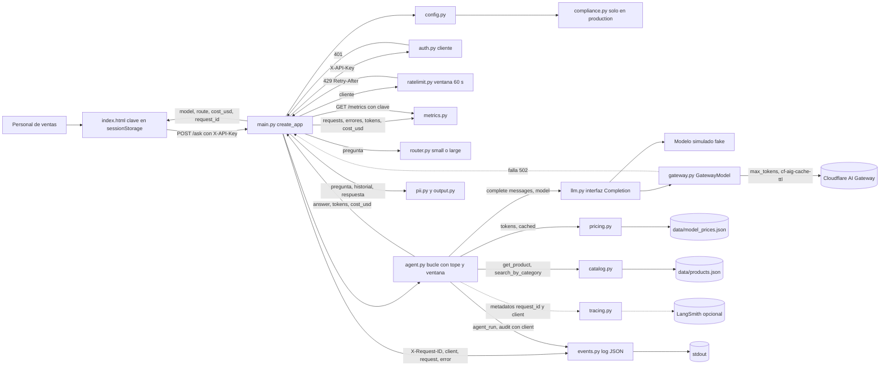
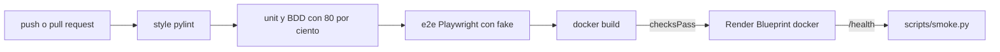

# Arquitectura del Catálogo de Productos

API web sin estado con un solo agente. El agente consulta un catálogo de productos de solo lectura
y usa un modelo detrás de una interfaz. La sesión 2 agrega observabilidad: id por petición,
log JSON, métricas del proceso y trazas opcionales. La sesión 3 agrega el modelo real por
Cloudflare AI Gateway y cuatro palancas de costo: enrutamiento, ventana de historial, tope de
salida y caché; cada respuesta informa su costo. La sesión 4 lo lleva a producción: clave por
cliente, límite de peticiones, reglas de compliance al arrancar, contenedor, CI y Render.

## Publicación

## Decisiones

- ADR 0001: API sin estado.
- ADR 0002: modelo detrás de la interfaz `complete(messages)`.
- ADR 0003: bucle del agente con tope de pasos.
- ADR 0004: log JSON por eventos, sin contenido.
- ADR 0005: trazas opcionales en LangSmith.
- ADR 0006: métricas por proceso y relojes inyectados.
- ADR 0007: el modelo devuelve un `Completion` (tokens y caché) y el gateway falla como 502.
- ADR 0008: enrutador de modelo por regla en código.
- ADR 0009: costo calculado con una tabla de precios, también para el simulado.
- ADR 0010: una clave por cliente en `X-API-Key`, nunca registrada.
- ADR 0011: límite de peticiones por cliente en memoria, con reloj inyectado.
- ADR 0012: compliance como comprobación que impide arrancar en producción.
- ADR 0013: datos personales enmascarados o bloqueados en entrada y salida.
- ADR 0014: validación de la respuesta del modelo antes de entregarla.
